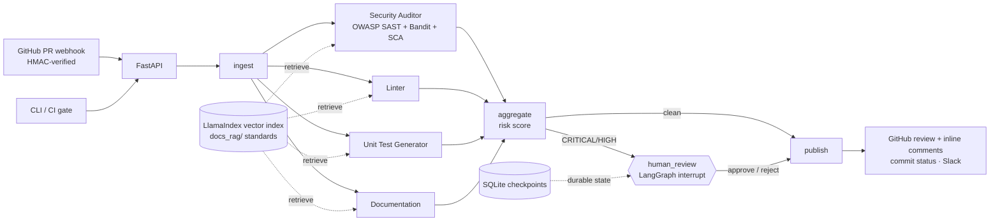

# Agentic AI Multi-Agent Code Review & Security Pipeline

An autonomous pull-request reviewer built with **LangGraph**, **LlamaIndex** and **FastAPI**. Four stateful agents run in parallel on every PR:

- **Security Auditor:** an OWASP Top 10 static analyser, cross-checked by Bandit, plus a dependency CVE audit.
- **Linter:** code-quality checks against the institutional coding standards.
- **Unit Test Generator:** writes runnable PyTest suites for the changed functions.
- **Documentation:** generates docstrings, an endpoint reference and a PR change summary.

Every finding cites the institutional coding/security standards it breaks, retrieved with vector RAG. When a CRITICAL or HIGH vulnerability shows up, the graph **pauses at a human-in-the-loop gate**. A reviewer then approves or rejects the PR through the API, Slack or the CLI. Results are posted back to GitHub as inline review comments plus a commit status, and the CI job blocks the merge before deployment.

The full pipeline works **offline with no API key** (deterministic analysis plus local embeddings). Set `OPENAI_API_KEY` to add GPT-4o-mini reviews and OpenAI embeddings on top.



---

## Resume claims → where they are implemented and verified

| Claim | Implementation | Verified by |
|---|---|---|
| Multi-agent pipeline with **LangGraph** | `src/graph/workflow.py`: fan-out from `ingest` to 4 agent nodes in one super-step, fan-in to `aggregate`; reducer-based shared state (`src/graph/state.py`) | `tests/test_workflow.py::test_graph_fans_out_to_all_agents_and_fans_in` |
| **LlamaIndex** vector RAG over institutional standards | `src/rag/vector_store.py`: one node per rule (51 rules in `docs_rag/`), `VectorStoreIndex` with a local IDF-weighted hashing embedding (`src/rag/embeddings.py`) or OpenAI embeddings; Qdrant optional | `tests/test_rag.py`: 22/22 labelled queries retrieve the right rule in the top 3 |
| **FastAPI** service | `main.py`, `src/api/webhooks.py`: webhook, review submission, HITL decision, report, standards search | `tests/test_api.py` |
| Automated code reviews, **dynamic security linting** | `src/analysis/`: diff parser with real line numbers; 53 native OWASP rules (Python AST + light taint tracking; JS/YAML/Dockerfile/.env patterns); Bandit mapped to OWASP; dependency CVE audit (A06) | `tests/test_security_engine.py` (62 labelled cases) |
| **Documentation generation** | `src/analysis/doc_synth.py`, `src/agents/documentation_agent.py`: Google-style docstrings with `Raises:` taken from guard clauses, endpoint reference with auth status, PR summary | `tests/test_quality_agents.py` |
| **Unit Test Generator** agent | `src/analysis/test_synth.py`: happy-path tests plus `pytest.raises` tests derived from guard clauses; collaborators replaced by `MagicMock`; output is checked to compile | `test_generated_tests_compile_and_pass_against_real_code` **runs** the generated tests in a subprocess and asserts they pass |
| **Stateful** agent nodes + **human-in-the-loop** validation | `human_review_node` calls LangGraph `interrupt()`; resume with `Command(resume=...)`; SQLite checkpointer keeps paused reviews across restarts | `test_critical_finding_pauses_at_hitl_gate_with_payload`, `test_human_approval_resumes_and_completes`, `test_hitl_state_survives_process_restart_with_sqlite` |
| Detects **OWASP Top 10** vulnerabilities **before deployment** | All 10 categories covered; CI job `ai-security-gate` fails the PR on CRITICAL/HIGH findings; GitHub commit status `agentic-code-review/security` can be made a required check | `scripts/evaluate_owasp.py`, `.github/workflows/ci.yml` |
| **Reduced PR review latency by 70%** | Parallel agents + per-file concurrency + a rate-limit semaphore + content-hash cache for re-reviews | `scripts/benchmark_latency.py`, `test_parallel_execution_is_faster_than_sequential` |

---

## Measured results

### OWASP Top 10 detection (`python -m scripts.evaluate_owasp`)

| Corpus | Vulnerable / safe cases | Recall | Precision | False-positive rate | Bandit-only recall |
|---|---|---|---|---|---|
| Development set (`benchmarks/owasp_cases.py`) | 45 / 17 | **100%** (10/10 categories) | **100%** | 0% | 40% |
| **Held-out set** (`benchmarks/owasp_holdout.py`) | 20 / 8 | **75%** | **100%** | 0% | 20% |

> **Read this honestly.** I wrote the development set alongside the rules, so it is a regression suite and not an independent benchmark. The held-out set uses different coding idioms and was written *after* the rules were frozen. No rules were tuned on it, so **75% is the more realistic estimate**. Known misses: `pathlib.Path(base, user_input)` traversal, SQL built across several concatenation steps, client-trusted values read through an intermediate variable, requirements files outside the standard names (`requirements/base.txt`), and SSRF through `httpx.AsyncClient`.

### Pipeline latency (`python -m scripts.benchmark_latency`)

Test setup: a synthetic 8-file PR; each LLM call is simulated at 1.0 s (25 LLM calls per review); medians of 3 runs; 4 file workers; LLM concurrency capped at 8.

| Scenario | Median wall-clock | Reduction vs. sequential |
|---|---|---|
| Sequential baseline (agents one after another, one file at a time) | 25.1 s | — |
| LangGraph parallel agents | 8.1 s | **67.9%** |
| Parallel agents + per-file concurrency | 4.0 s | **84.0%** |
| Re-review after a push touching 2 of 8 files (content-hash cache) | 1.0 s | **95.9%** |
| Static analysis only (no LLM) | 0.07 s | — |

> The benchmark measures **orchestration latency** with a fixed simulated LLM latency, so it is reproducible and costs nothing to run. Run `python -m scripts.benchmark_latency --provider openai` with a key to measure against the real API. Real speed-ups depend on your provider's rate limits (`LLM_MAX_CONCURRENCY`).

### Tests

`pytest -q` → **126 tests**: unit, integration (full graph + API) and generated-test execution.

---

## Quick start

**Windows (PowerShell)**
```powershell
python -m venv venv; .\venv\Scripts\Activate.ps1
pip install -r requirements.txt
Copy-Item .env.example .env
pytest -q
python -m src.cli review --files examples/vulnerable_app.py --report review.md --write-tests generated_tests
uvicorn main:app --reload        # Swagger UI at http://127.0.0.1:8000/docs
```

**macOS / Linux**
```bash
python -m venv venv && source venv/bin/activate
pip install -r requirements.txt && cp .env.example .env
pytest -q
python -m src.cli review --files examples/vulnerable_app.py --report review.md
```

**Docker:** `docker compose up --build` (add `--profile qdrant` to also start Qdrant).

### CLI

```bash
python -m src.cli review --git origin/main...HEAD --fail-on CRITICAL,HIGH   # CI gate on your branch
python -m src.cli review --diff changes.diff --interactive                  # approve/reject at the HITL gate
python -m src.cli scan src/ --fail-on HIGH                                  # SAST only
python -m scripts.evaluate_owasp                                            # detection benchmark
python -m scripts.benchmark_latency --files 8 --latency 1.0                 # latency benchmark
```

### API

| Method | Path | Purpose |
|---|---|---|
| `POST` | `/api/v1/webhooks/github` | GitHub `pull_request` webhook (HMAC `X-Hub-Signature-256`); fetches the PR files and starts a review |
| `POST` | `/api/v1/reviews` | Submit files/diffs directly (`wait=true` returns the full result) |
| `GET` | `/api/v1/reviews/{thread_id}` | Review state, findings, pending HITL payload |
| `POST` | `/api/v1/reviews/{thread_id}/decision` | Human decision `{"approved": bool, "feedback": str, "reviewer": str}` → resumes the graph |
| `GET` | `/api/v1/reviews/{thread_id}/report` | Markdown report |
| `POST` | `/api/v1/analyze/security` | SAST on a single file, no graph |
| `GET` | `/api/v1/standards/search?q=` | Vector search over institutional standards |

All operator endpoints require `X-API-Key` (`REVIEW_API_KEY`) in production. Unsigned webhooks are only accepted when `APP_ENV=development`.

### Human-in-the-loop flow

1. `aggregate` scores the risk. If any finding is in `HITL_BLOCK_SEVERITIES` (default `CRITICAL,HIGH`), it sends a Slack alert and routes to `human_review`.
2. `human_review` calls `interrupt(payload)`. The graph state is checkpointed to SQLite, and the GitHub commit status is `pending`.
3. A reviewer `POST`s a decision. The graph resumes with `Command(resume=...)`, then `publish` posts the review: **REQUEST_CHANGES** on rejection, or a comment noting the accepted risk on approval. The commit status is set to `failure`/`success`.

---

## Project layout

```
src/
  analysis/   diff_parser · python_rules (OWASP AST+taint) · pattern_rules (JS/config/secrets/SCA)
              bandit_runner · lint_rules · code_model · test_synth · doc_synth · findings
  agents/     security_agent · linter_agent · test_generator_agent · documentation_agent · llm · base
  graph/      state · workflow · runner · checkpoints
  rag/        vector_store · embeddings
  api/        webhooks · schemas · security
  services/   github_service · github_publisher · slack_service · report
  cli.py
docs_rag/     institutional standards indexed for RAG (SEC-xx, STD-xx, TST-xx, DOC-xx)
benchmarks/   OWASP development + held-out corpora, results/
scripts/      evaluate_owasp.py · benchmark_latency.py
examples/     vulnerable_app.py (deliberately insecure demo — do not deploy)
```

## Limitations

- Taint tracking happens inside a single function and doesn't cross modules. Native AST rules are Python-only; other languages get pattern rules.
- The dependency audit uses a small offline advisory list (`src/analysis/advisories.json`). Use `pip-audit` or Dependabot for full coverage.
- Generated tests cover signatures and guard clauses. They are a starting point and still need meaningful value assertions from a human.
- LLM findings are kept only if they point at a real added line and a valid OWASP category. They still deserve reviewer judgement.
